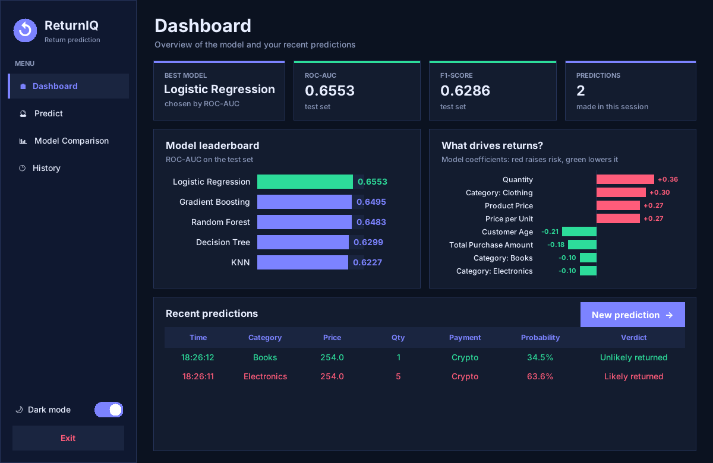
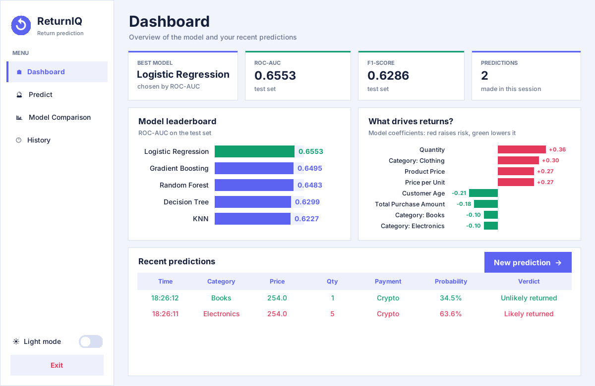
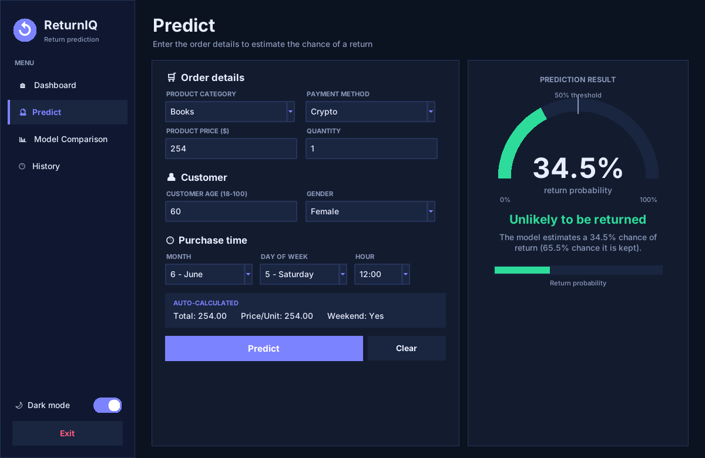
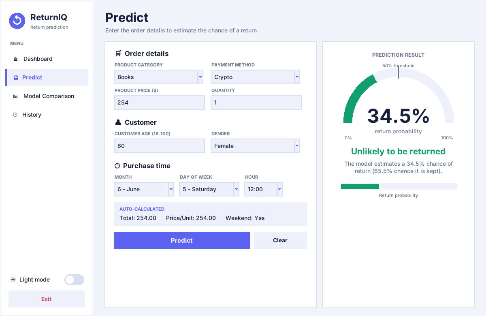
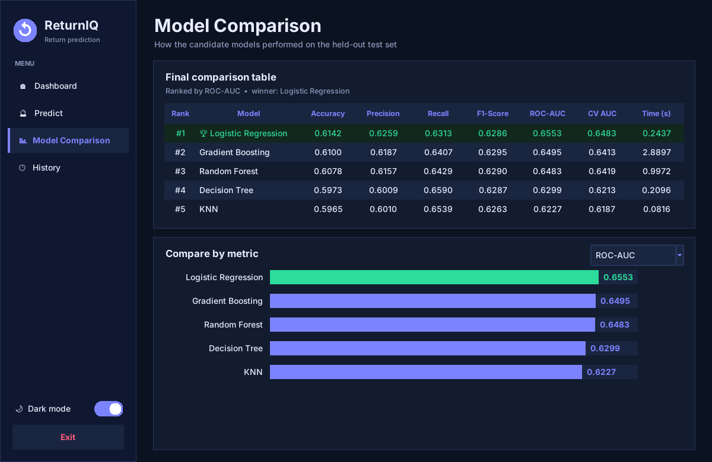
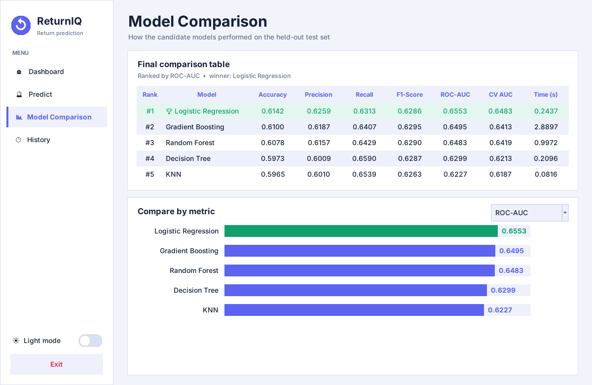
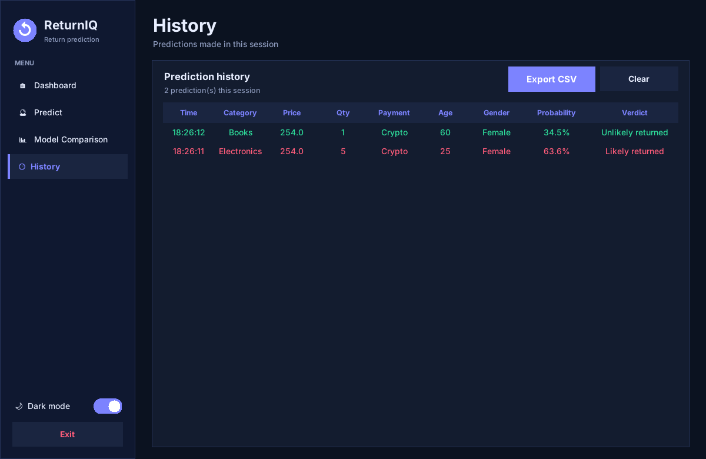
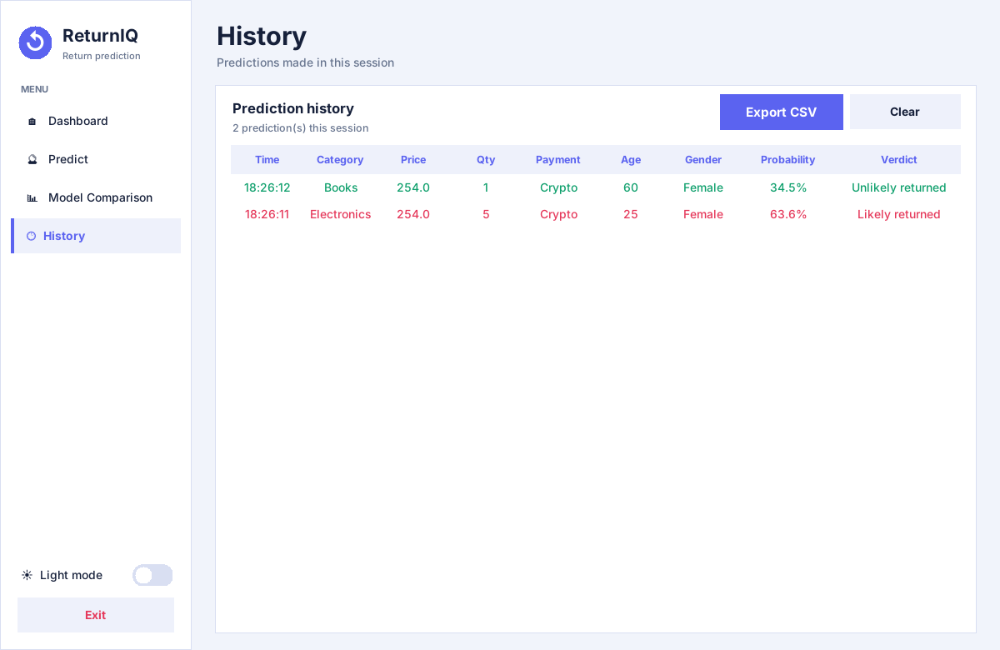

# 🔮 E-Commerce Return Prediction

A desktop dashboard (Python + Tkinter) that predicts the probability that an online order will be **returned**, using a trained scikit-learn pipeline. It includes a prediction form, a model-comparison page, a prediction history and a dark / light theme.



---

## Table of contents

1. [Features](#features)
2. [Screenshots](#screenshots)
3. [Project structure](#project-structure)
4. [Installation and running](#installation-and-running)
5. [How it works](#how-it-works)
6. [Model performance](#model-performance)
7. [Testing](#testing)
8. [Limitations](#limitations)
9. [Viva cheat-sheet](#viva-cheat-sheet)

---

## Features

| Area | What it does |
|---|---|
| **Predict** | 9 inputs (dropdowns, entries) with sensible **default values**; live preview of auto-calculated fields; animated probability gauge, progress bar and a red / green verdict |
| **Dashboard** | Summary cards, model leaderboard, "what drives returns" factor chart, recent predictions |
| **Model Comparison** | Table and bar chart read from `model_comparison.csv`; switch the chart between Accuracy, Precision, Recall, F1 and ROC-AUC |
| **History** | Every prediction in the session, with **Export CSV** |
| **Theme** | One-click **dark / light** switch in the sidebar; your inputs and history are kept |
| **Validation** | Numbers only, age 18–100, quantity ≥ 1, price > 0, all dropdowns chosen; errors shown in a message box |
| **Window** |  Resizable, sidebar navigation like a small web app |

---

## Screenshots

### Dashboard

| Dark | Light |
|---|---|
|  |  |

### Predict

The form starts with default values (the dataset medians). The gauge fills to the predicted return probability; **≥ 50 %** shows *Likely to be RETURNED* in red, otherwise *Unlikely to be returned* in green.

| Dark | Light |
|---|---|
|  |  |

### Model Comparison

| Dark | Light |
|---|---|
|  |  |

### History

| Dark | Light |
|---|---|
|  |  |

---

## Project structure

```
project/
├── app.py                  # the whole GUI application (single file)
├── return_model.joblib     # trained scikit-learn Pipeline (preprocessing + model)
├── gui_schema.json         # dropdown options, numeric min/max/median, feature_order
├── model_comparison.csv    # final comparison table from the notebook
├── requirements.txt
├── README.md
├── E_Commerce_Return_Prediction.ipynb   # training notebook
├── screenshots/            # images used in this README
└── tests/
    ├── test_app.py         # 20 automated tests
    ├── test_results.txt    # output of the last test run
    └── make_screenshots.py # regenerates the screenshots
```

---

## Installation and running

```bash
pip install -r requirements.txt
python app.py
```

- Python 3.9+ with **tkinter** (included with the Windows / macOS installers; on Linux: `sudo apt install python3-tk`).
- Keep scikit-learn at **1.7.2**, the version the model was saved with. Other versions can load it with warnings or fail.
- `app.py`, `return_model.joblib`, `gui_schema.json` and `model_comparison.csv` must stay in the same folder.

---

## How it works

### 1. Prediction flow

```
User inputs ──► validation ──► add auto-calculated features ──► 1-row DataFrame
                                                                      │
        red / green message ◄── probability ◄── model.predict_proba ◄─┘
```

The model expects **12 columns in an exact order** (taken from `feature_order` in `gui_schema.json`).

| Column | Source |
|---|---|
| Product Category, Payment Method, Gender | Dropdown (options from `gui_schema.json`) |
| Product Price, Quantity, Customer Age | Entry (validated) |
| Purchase_Month, Purchase_DayOfWeek, Purchase_Hour | Dropdown |
| **Total Purchase Amount** | auto = `Product Price × Quantity` |
| **Price_per_Unit** | auto = `Product Price` |
| **Is_Weekend** | auto = `1` if day is 5 or 6 (Sat / Sun), else `0` |

The probability shown is `model.predict_proba(df)[0, 1]`, the chance of class 1 (**returned**).

### 2. Validation rules

| Field | Rule |
|---|---|
| Product Price | a number greater than 0 |
| Quantity | a whole number, 1 or more |
| Customer Age | a whole number from 18 to 100 |
| Dropdowns | something must be selected |

### 3. Dark / light mode

Two colour dictionaries (`DARK`, `LIGHT`) exist in the code. A global `T` always holds the active one. Clicking the switch copies the other palette into `T` and redraws the window. Form values live in Tkinter `StringVar`s and the history in a list, so neither is lost when the theme changes.

### 4. Default values

`default_inputs()` reads the medians in `gui_schema.json` (price 254, quantity 3, age 44, June, Thursday, 12:00). The **Clear** button restores them.

### 5. Custom drawing

The gauge, switch and bar charts are drawn on `tk.Canvas`, so no extra plotting library is needed.

---

## Model performance

Results from the notebook on the held-out test set (`model_comparison.csv`), ranked by ROC-AUC:

| Rank | Model | Accuracy | Precision | Recall | F1 | ROC-AUC | CV ROC-AUC |
|---|---|---|---|---|---|---|---|
| 🏆 1 | **Logistic Regression** | 0.6142 | 0.6259 | 0.6313 | 0.6286 | **0.6553** | 0.6483 |
| 2 | Gradient Boosting | 0.6100 | 0.6187 | 0.6407 | 0.6295 | 0.6495 | 0.6413 |
| 3 | Random Forest | 0.6078 | 0.6157 | 0.6429 | 0.6290 | 0.6483 | 0.6419 |
| 4 | Decision Tree | 0.5973 | 0.6009 | 0.6590 | 0.6287 | 0.6299 | 0.6213 |
| 5 | KNN | 0.5965 | 0.6010 | 0.6539 | 0.6263 | 0.6227 | 0.6187 |

The saved model is a scikit-learn `Pipeline`: median imputation and standard scaling for numeric columns, most-frequent imputation and one-hot encoding for categorical columns, then a class-weight-balanced logistic regression.

> The notebook also tuned Random Forest and Gradient Boosting, but their test scores are not printed as text in the notebook, so they are not in `model_comparison.csv`. Their best cross-validated ROC-AUC was about 0.644 for both, still below Logistic Regression.

---

## Testing

All tests are in `tests/test_app.py`. They load the **real model** and drive the **real GUI** (message boxes are captured, so nothing blocks).

```bash
python tests/test_app.py
# no display (server / CI):  xvfb-run -a python tests/test_app.py
```

### Result: 20 / 20 passed

| ID | Test | Result | Detail |
|---|---|---|---|
| T01 | Model and schema files load | ✅ PASS | |
| T02 | `feature_order` matches the model's training columns | ✅ PASS | 12 columns, same order |
| T03 | `model_comparison.csv` has 5 models; best equals `best_model` in schema | ✅ PASS | Logistic Regression, 0.6553 |
| T04 | Window title is correct and window is not resizable | ✅ PASS | |
| T05 | Default inputs come from schema medians | ✅ PASS | 254, 3, 44, June, Thursday, 12:00 |
| T06 | All four pages render without errors | ✅ PASS | |
| T07 | Total = Price × Quantity is auto-calculated | ✅ PASS | 254 × 5 = 1,270.00 |
| T08 | Is_Weekend is Yes only for Saturday and Sunday | ✅ PASS | all 7 days checked |
| T09 | Validation rejects 13 bad inputs with an error popup | ✅ PASS | see table below |
| T10 | Validation accepts boundary values | ✅ PASS | age 18 and 100, qty 1, price 0.01 |
| T11 | Missing dropdown selection shows an error | ✅ PASS | |
| T12 | Default input gives a probability between 0 and 1 | ✅ PASS | 47.7 % |
| T13 | App probability equals a direct `predict_proba` call | ✅ PASS | 0.624595 = 0.624595 |
| T14 | Probability ≥ 50 % shows "Likely to be RETURNED" in red | ✅ PASS | 56.5 % |
| T15 | Probability < 50 % shows "Unlikely to be returned" in green | ✅ PASS | 33.9 % |
| T16 | Progress bar matches the probability | ✅ PASS | |
| T17 | Sweep of 128 category / payment / gender / weekday / quantity combinations | ✅ PASS | no errors, range 38.2 %–67.0 % |
| T18 | Clear restores default values and resets the result | ✅ PASS | |
| T19 | Dark / light toggle changes the palette and keeps inputs and history | ✅ PASS | |
| T20 | History records predictions; Export CSV writes a valid file | ✅ PASS | |

The raw output of the last run is in [`tests/test_results.txt`](tests/test_results.txt).

### Validation test cases (T09)

| Field | Input | Expected | Result |
|---|---|---|---|
| Price | `abc` | error | ✅ rejected |
| Price | `0` | error | ✅ rejected |
| Price | `-5` | error | ✅ rejected |
| Price | *(empty)* | error | ✅ rejected |
| Quantity | `0` | error | ✅ rejected |
| Quantity | `-1` | error | ✅ rejected |
| Quantity | `2.5` | error | ✅ rejected |
| Quantity | `abc` | error | ✅ rejected |
| Age | `17` | error | ✅ rejected |
| Age | `101` | error | ✅ rejected |
| Age | `abc` | error | ✅ rejected |
| Age | *(empty)* | error | ✅ rejected |
| Age | `30.5` | error | ✅ rejected |
| Age | `18`, `100` | accepted | ✅ accepted (T10) |

### Sample predictions

| Scenario | Probability | Message |
|---|---|---|
| Electronics, quantity 5, Crypto, age 25, Saturday | 63.6 % | Likely to be RETURNED (red) |
| Books, quantity 1, age 60 | 34.5 % | Unlikely to be returned (green) |

These are the two rows shown in the History screenshots.

> Tests were run on Linux with Python 3.12, scikit-learn 1.7.2, inside a virtual display. Fonts and exact pixel layout can differ slightly on Windows and macOS.

---

## Limitations

- **Modest predictive power.** The best ROC-AUC is about 0.655, so the model is better than guessing but far from certain. Treat the percentage as a risk score, not a guarantee. This is worth stating in your viva.
- **Association, not cause.** The factor chart on the dashboard shows what the model learned from the data. It does not prove that a feature causes returns.
- **Session-only history.** History resets when the app closes unless you click **Export CSV**.
- **Same-folder files.** The model must be loaded with the scikit-learn version it was saved with.

---

## Viva cheat-sheet

**Why logistic regression as the final model?**
It had the highest ROC-AUC on the test set (0.6553) and the best cross-validated score, and it is fast and easy to explain. The more complex models did not beat it.

**What does `predict_proba(df)[0, 1]` mean?**
`predict_proba` returns one row per sample with the probabilities of class 0 (kept) and class 1 (returned). `[0, 1]` is the first row, class 1, which is the chance of return.

**Why is Total Purchase Amount calculated and not asked?**
It is `Price × Quantity`, so asking for it could create inconsistent inputs. Price_per_Unit and Is_Weekend are derived the same way, exactly as they were when the model was trained.

**Why must the columns be in a fixed order?**
The pipeline's preprocessing was fitted on named columns in a specific order. `feature_order` guarantees the GUI builds the same layout.

**Why a Pipeline?**
Imputation, scaling, one-hot encoding and the classifier are saved together, so the GUI can pass raw values and no preprocessing code is duplicated.

**What does the 50 % threshold mean?**
If the predicted chance of return is at least 50 %, the app labels the order *Likely to be RETURNED*. The model was trained with balanced class weights, so 50 % is a fair cut-off.

**How does the theme switch work?**
Two palettes are stored as dictionaries; clicking the switch swaps the active one and re-renders the UI, while the data stays in Tkinter variables.

**Why ROC-AUC for comparison?**
It measures how well the model ranks returned orders above kept ones across all thresholds, so it does not depend on one cut-off.
